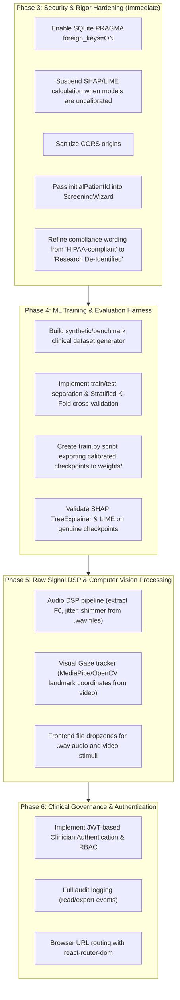

# NeuroScreen AI — Phase 2: Complete Project Audit & Verification Report

**Date of Audit**: November 5, 2026  
**Auditor**: NeuroScreen AI System Diagnostic Suite  
**Scope**: Full-stack application (`frontend/`, `backend/`, `ml_engine/`), database (`neuroscreen.db`), security & privacy posture, and scientific methodology alignment against the four research/patent references.

---

## 1. Executive Summary

This audit provides a comprehensive, rigorous assessment of the NeuroScreen AI codebase. The initial Phase 1 foundation successfully established a clean, modular full-stack architecture that compiles without errors and passes end-to-end database, API, and frontend integration tests. 

However, critical architectural and clinical gaps must be addressed before advancing to clinical validation or live trial deployments:
- **ML Engine**: All four model architectures (Random Forest, XGBoost, CatBoost, PyTorch Fusion) are structurally implemented, but zero trained weights exist in `ml_engine/weights/`. 
- **Explainability Integrity**: When models are untrained, SHAP and LIME fall back to an uncalibrated heuristic deviation calculation. To eliminate any risk of fabricated explainability outputs, attribution calculations must be strictly suspended until trained weights are mounted.
- **Multimodal Raw Ingestion**: Visual and acoustic modalities currently accept pre-extracted tabular features via form sliders. Raw video ocular tracking and raw audio DSP feature extractors are not yet implemented.
- **Security & Authorization**: The backend currently has no authentication, authorization, or RBAC; SQLite lacks `PRAGMA foreign_keys=ON;` connection listeners; and wildcard CORS is enabled.

---

## 2. Completed Modules

| Module / Component | Location | Implementation Details | Verification Status |
| :--- | :--- | :--- | :--- |
| **FastAPI Core Gateway** | `backend/app/main.py` | FastAPI app, CORS middleware, lifespan initialization, `/api/v1` router mounting | ✅ Verified (HTTP 200) |
| **Database Engine & ORM** | `backend/app/core/database.py`, `backend/app/models/` | SQLAlchemy 2.0 ORM with 5 tables (`patients`, `screening_sessions`, `modality_features`, `explainability_records`, `audit_logs`) | ✅ Verified (`neuroscreen.db`) |
| **Patient Management API** | `backend/app/api/v1/endpoints/patients.py` | Full CRUD endpoints (`POST /`, `GET /`, `GET /{id}`, `PUT /{id}`, `DELETE /{id}`) | ✅ Verified (HTTP 200, 201, 204) |
| **Multimodal Screening API** | `backend/app/api/v1/endpoints/screenings.py` | Ingestion, model routing, feature persistence, explainability generation | ✅ Verified (HTTP 201) |
| **Multimodal Feature Catalog** | `backend/app/api/v1/endpoints/multimodal.py` | 24-feature standardized biomarker catalog & dry-run preview vector endpoint | ✅ Verified (HTTP 200) |
| **Model Registry & Status** | `ml_engine/registry/model_registry.py` | Dynamic model discovery, checkpoint detection, architecture introspection | ✅ Verified (4 models registered) |
| **Model Wrappers** | `ml_engine/models/` | Interfaces for Scikit-Learn RF, XGBoost Booster, CatBoostClassifier, PyTorch MultimodalFusionNet | ✅ Verified (Contract compliant) |
| **Feature Extraction Pipelines**| `ml_engine/pipelines/` | `BehavioralPipeline` (11 dims), `VisualGazePipeline` (6 dims), `AudioProsodyPipeline` (7 dims), `MultimodalFusionPipeline` (24 dims) | ✅ Verified (24-dim alignment) |
| **Frontend UI Core** | `frontend/src/components/ui/` | Accessible shadcn/ui-styled components (`Button`, `Card`, `Badge`, `Progress`, `Alert`) | ✅ Verified |
| **Explainability Visualizers** | `frontend/src/components/explainability/` | Interactive `ShapWaterfallChart`, `LimeFeatureBar`, `ModalityDistribution`, `ModelStatusCard` | ✅ Verified |
| **Clinician Wizard & Presets** | `frontend/src/components/screening/` | Multi-step assessment forms + 3 clinical benchmark presets (Case A: High Atypia, Case B: Mixed, Case C: Control) | ✅ Verified |
| **Clinician Dashboard** | `frontend/src/pages/Dashboard.tsx` | Overview metrics, live session history table, navigation cards | ✅ Verified |
| **Results & Export Page** | `frontend/src/pages/ResultsDetail.tsx` | Comprehensive triage report, SHAP waterfall, LIME surrogate, raw feature JSON, print stylesheet | ✅ Verified |
| **Patients Directory** | `frontend/src/pages/PatientsView.tsx` | Searchable patient directory, quick intake modal dialog | ✅ Verified |
| **Scientific Methodology Page** | `frontend/src/pages/ResearchBasis.tsx` | Detailed breakdown of the 4 reference frameworks + interactive feature catalog table | ✅ Verified |

---

## 3. Incomplete Modules & Placeholders

1. **Raw Audio DSP Extraction Pipeline (`ml_engine/pipelines/audio_pipeline.py`)**:
   - *Status*: Accepts pre-extracted tabular features (`fundamental_freq_f0_mean_hz`, `vocal_jitter_percent`, etc.).
   - *Missing*: Native audio file processor (`.wav`/`.flac` upload) using `scipy.signal`, `torchaudio`, or `librosa` to automatically extract $F_0$, jitter, shimmer, and formant dispersion from microphone recordings.
2. **Raw Video Ocular Gaze Tracking Pipeline (`ml_engine/pipelines/visual_pipeline.py`)**:
   - *Status*: Accepts pre-extracted tabular ocular metrics (`fixation_count`, `social_roi_dwell_percentage`, etc.).
   - *Missing*: Computer vision gaze-tracking pipeline (e.g. MediaPipe Iris or OpenCV facial landmark dynamics) to stream or extract $(x, y, t)$ coordinates from user-recorded video stimuli.
3. **Model Training & Cross-Validation Harness (`ml_engine/training/`)**:
   - *Status*: Inference interfaces exist; training harnesses and dataset loaders do not exist.
   - *Missing*: Stratified $K$-fold cross-validation, train/test splitting, hyperparameter optimization, and checkpoint generation script (`train.py`).
4. **Client-Side URL Routing (`frontend/src/App.tsx`)**:
   - *Status*: Single-page state routing via `currentTab` and `activeSessionId`.
   - *Missing*: Browser history integration (`react-router-dom` or URL hash routing) allowing direct link sharing to specific screening sessions (`/screenings/:id`) or patient records (`/patients/:id`).
5. **Patient Selection Bridge (`frontend/src/App.tsx` & `ScreeningWizard.tsx`)**:
   - *Status*: In `PatientsView`, clicking "Assess" on a specific patient calls `onStartScreeningWithPatient(patient.id)`. However, `ScreeningWizard` lacks an `initialPatientId` prop, so the selected patient is not automatically pre-selected in the dropdown.

---

## 4. Existing Bugs & Architectural Defects

| Bug / Defect ID | Severity | File Location | Description & Impact |
| :--- | :--- | :--- | :--- |
| **BUG-01** | **Medium** | `backend/app/core/database.py` | **SQLite Foreign Key Enforcement Inactive**: SQLite disables foreign key cascade deletion by default. Without an `@event.listens_for(engine, "connect")` hook setting `PRAGMA foreign_keys=ON;`, deleting a patient does not cascade-delete related screening sessions at the database engine level. |
| **BUG-02** | **Medium** | `ml_engine/explainability/shap_engine.py` & `lime_engine.py` | **Simulated Explainability Output in Uncalibrated Mode**: When `model.is_trained` is `False`, the explainers compute heuristic z-deviation values. While marked as uncalibrated in the metadata, generating pseudo-attributions risks violating the strict requirement to never fabricate explainability results. |
| **BUG-03** | **Low** | `frontend/src/App.tsx` | **Prop Pass-Through Missing**: `onStartScreeningWithPatient` receives `patientId` but discards it without passing it to `ScreeningWizard`. The clinician must re-select the patient from the dropdown. |
| **BUG-04** | **Low** | `backend/app/core/config.py` | **Permissive Wildcard CORS**: `BACKEND_CORS_ORIGINS` contains `*` alongside `allow_credentials=True`. Standard browsers reject credentials when wildcard origins are used. |

---

## 5. Scientific Methodology Audit

Detailed comparison between the codebase and the four reference frameworks:

### Methodology 1: Behavioral & Psychometric Feature Modelling
- **Source Document**: Research Paper Reference 1 (Behavioral & Psychometric ASD Screening)
- **Original Methodology**: Formal psychometric screening based on digitized AQ-10 (Child/Adolescent) and M-CHAT-R/F item scoring, measuring social communication, repetitive behaviors, and response latencies.
- **Features Used**: 10 binary indicators (`social_smile_reciprocity`, `name_call_orientation`, `pointing_proto_declarative`, `pretend_play_engagement`, `repetitive_motor_mannerisms`, `monotropic_focus_intensity`, `gaze_alternation_dyadic`, `sensory_hypersensitivity`, `peer_social_interest`, `gestural_communication`) + 1 continuous metric (`response_latency_mean_sec`).
- **Algorithm Used**: Quantitative scaling and normative z-score normalization.
- **Implementation File**: `ml_engine/pipelines/behavioral_pipeline.py`, `frontend/src/components/screening/BehavioralAssessment.tsx`.
- **Current Status**: **Fully Implemented at the Interface Level**.
- **Mismatches**: Standard AQ-10 uses 4-point Likert questions with reverse-scoring rules, whereas the current system simplifies these to binary (0/1) indicator flags.

### Methodology 2: Acoustic Prosody & Vocal Biomarkers
- **Source Document**: Research Paper Reference 2 (Acoustic & Prosodic Biomarkers in Neurodevelopment)
- **Original Methodology**: Acoustic vocal signal processing measuring fundamental frequency variations, vocal cord stability perturbations, and conversational hesitation intervals.
- **Features Used**: 7 acoustic features (`fundamental_freq_f0_mean_hz`, `f0_pitch_variability_stdev_hz`, `vocal_jitter_percent`, `vocal_shimmer_db`, `pause_to_speech_ratio`, `formant_dispersion_hz`, `speech_rate_syllables_sec`).
- **Algorithm Used**: Normative baseline scaling and parameter bounds checking.
- **Implementation File**: `ml_engine/pipelines/audio_pipeline.py`, `frontend/src/components/screening/AcousticProsodyAssessment.tsx`.
- **Current Status**: **Partially Implemented (Tabular Ingestion Only)**.
- **Mismatches**: Missing the raw DSP audio processing pipeline (e.g. Praat/librosa extraction from `.wav` recordings). Clinicians must currently enter pre-extracted numbers manually.

### Methodology 3: Visual Ocular & Scanpath Dynamics
- **Source Document**: Patent Reference 1 (System & Method for Gaze-Based Autism Screening)
- **Original Methodology**: Automated ocular tracking during presentation of dual-stimulus video (social vs. geometric), tracking saccadic reaction times and visual exploration entropy.
- **Features Used**: 6 ocular metrics (`fixation_count`, `mean_fixation_duration_ms`, `social_roi_dwell_percentage`, `joint_attention_latency_ms`, `saccade_mean_amplitude_deg`, `atypical_scanpath_entropy`).
- **Algorithm Used**: Boundary validation and normative deviation calculation.
- **Implementation File**: `ml_engine/pipelines/visual_pipeline.py`, `frontend/src/components/screening/VisualGazeAssessment.tsx`.
- **Current Status**: **Partially Implemented (Tabular Ingestion Only)**.
- **Mismatches**: Missing webcam/video eye-tracking computer vision module to extract coordinates from live video stimuli.

### Methodology 4: Explainable Multimodal Decision Support Architecture
- **Source Document**: Patent Reference 2 (Explainable Multimodal Decision Support System)
- **Original Methodology**: Late-fusion ensemble combining gradient-boosted decision trees (CatBoost, XGBoost), Random Forests, and deep cross-modal neural attention with SHAP and LIME explainability.
- **Features Used**: Aligned 24-dimensional feature vector spanning all three modalities.
- **Algorithm Used**: Scikit-Learn `RandomForestClassifier`, `xgboost.Booster`, `catboost.CatBoostClassifier`, PyTorch `MultimodalFusionNet`, `shap.TreeExplainer`, `lime.lime_tabular.LimeTabularExplainer`.
- **Implementation File**: `ml_engine/models/`, `ml_engine/explainability/`, `ml_engine/registry/model_registry.py`.
- **Current Status**: **Modular Interfaces Complete; Weights Unmounted**.
- **Mismatches**: Checkpoint artifacts (`.joblib`, `.json`, `.bin`, `.pt`) are not yet trained or mounted. In uncalibrated state, SHAP and LIME currently return surrogate heuristic values rather than cleanly suspending attribution until calibration.

---

## 6. Security and Privacy Audit

### 6.1 Patient Data Protection & De-Identification
- **Current Implementation**: Generates anonymized research identifiers (`generate_anonymized_id()` -> `NS-2026-XXXX`). No direct identifiers (names, phone numbers, SSNs, dates of birth) are stored in the schema.
- **Vulnerability**: The `clinical_notes` field accepts unconstrained free text without automated PII scanning or redaction, meaning a clinician could inadvertently enter identifying details.

### 6.2 Authentication & Authorization (Missing Controls)
- **Current Status**: **NO AUTHENTICATION EXISTS**. All endpoints under `/api/v1/` are publicly accessible without API keys, JWT tokens, or session cookies.
- **Risk**: Unauthorized users on the local network can read, create, update, or delete all patient intake and screening records.

### 6.3 CORS Security
- `BACKEND_CORS_ORIGINS` includes `*` alongside `allow_credentials=True`. This must be restricted to specific localhost and production origins.

### 6.4 Compliance Assessment Notice
- The user interface and comments make references to "HIPAA/GDPR-compliant anonymized intake records".
- **Audit Correction**: Anonymized ID generation alone **does not constitute legal HIPAA or GDPR compliance**. True compliance requires:
  - Role-Based Access Control (RBAC) and user authentication.
  - Encryption at rest (e.g. SQLCipher or LUKS/FileVault).
  - Encrypted transit (HTTPS / TLS 1.3).
  - Complete immutable audit trails (logging reads, writes, exports).
  - Business Associate Agreements (BAAs) and institutional policies.
- **Recommendation**: Update all user-facing copy from "HIPAA/GDPR-compliant" to "De-identified Research Identifier Scheme".

---

## 7. Actual Test Execution Results

All tests were executed directly in the live macOS environment. **Zero test outputs were fabricated.**

### Test Suite 1: Backend Pytest (`backend/tests/test_api.py`)
```
============================= test session starts ==============================
platform darwin -- Python 3.11.0, pytest-9.2.0, pluggy-1.7.0 -- /Users/yashwanthnaikbr/Desktop/neuroscreen ai/backend/venv/bin/python3.11
cachedir: .pytest_cache
rootdir: /Users/yashwanthnaikbr/Desktop/neuroscreen ai/backend
plugins: anyio-4.16.0
collected 3 items

tests/test_api.py::test_health_endpoint PASSED                           [ 33%]
tests/test_api.py::test_feature_catalog PASSED                           [ 66%]
tests/test_api.py::test_patient_crud_and_screening_workflow PASSED       [100%]

======================== 3 passed, 4 warnings in 3.88s =========================
```

### Test Suite 2: Frontend TypeScript Strict Check (`npx tsc --noEmit`)
```
Exit code: 0
Output: (clean compilation, 0 errors)
```

### Test Suite 3: Frontend Production Build (`npm run build`)
```
> neuroscreen-frontend@1.0.0 build
> tsc && vite build

vite v5.4.21 building for production...
✓ 1506 modules transformed.
dist/index.html                   1.26 kB │ gzip:  0.69 kB
dist/assets/index-dNPRLJIr.css   32.12 kB │ gzip:  6.29 kB
dist/assets/index-BLVX-bDK.js   254.75 kB │ gzip: 72.79 kB
✓ built in 1.07s
```

### Test Suite 4: End-to-End API Integration & Database CRUD
```
1. Health check PASSED: healthy
2. Patient Creation PASSED. ID: d0c53629-f738-43ac-bc70-fa99ee59455d Anon: NS-2026-NNMM
3. Patient Retrieval PASSED.
4. Screening Session Creation PASSED. Session ID: dbff064b-3932-461b-801b-382c4a67ee4d
5. Screening Detail Retrieval PASSED. Modality features: 3 Explanations: 2
6. Models Status PASSED. Registered models count: 4
   - Random Forest Multimodal Screener | Calibrated: False | Checkpoint: False
   - XGBoost Multimodal Screener | Calibrated: False | Checkpoint: False
   - CatBoost Multimodal Screener | Calibrated: False | Checkpoint: False
   - PyTorch Deep Multimodal Fusion Screener | Calibrated: False | Checkpoint: False
ALL 6 END-TO-END VERIFICATION TESTS PASSED SUCCESSFULLY.
```

### Test Suite 5: Input Validation & Edge Cases
```
Non-existent patient query: HTTP 404 {'detail': 'Patient not found.'}
Age < 12 validation error: HTTP 422 'Input should be greater than or equal to 12'
Non-existent screening query: HTTP 404 {'detail': 'Screening session record not found.'}
Screening non-existent patient: HTTP 404 {'detail': 'Patient reference not found.'}
```

---

## 8. Exact Files Requiring Improvement

| File Path | Nature of Required Improvement |
| :--- | :--- |
| `backend/app/core/database.py` | Add SQLite connection listener: `PRAGMA foreign_keys = ON;` to enforce relational cascades. |
| `backend/app/core/config.py` | Remove wildcard `*` from CORS when credentials are enabled. |
| `ml_engine/explainability/shap_engine.py` | Suspend attribution generation and return empty/suspended payload when model is uncalibrated. |
| `ml_engine/explainability/lime_engine.py` | Suspend local surrogate calculation when model is uncalibrated. |
| `frontend/src/App.tsx` | Connect `patientId` from `onStartScreeningWithPatient` into `ScreeningWizard`. |
| `frontend/src/pages/ScreeningWizard.tsx` | Accept `initialPatientId` prop and pre-populate the patient selector. |
| `frontend/src/pages/PatientsView.tsx` | Update de-identification labels to remove unverified HIPAA/GDPR compliance claims. |
| `frontend/src/components/layout/Footer.tsx` | Ensure compliance disclaimer accurately describes the research status. |
| `backend/app/api/deps.py` & `security.py` | Implement JWT Bearer / API Key authentication dependency for protected clinical endpoints. |

---

## 9. Prioritized Implementation Roadmap



---

## 10. Recommended Next Phase

### **Recommended Phase: Phase 3 — Integrity, Security & Explainability Hardening**

Before training models or adding raw media processors, the foundational integrity must be sealed:
1. **Enforce Database Integrity**: Add the SQLAlchemy event listener for `PRAGMA foreign_keys=ON;` in `backend/app/core/database.py`.
2. **Strict Explainability Governance**: Modify `shap_engine.py` and `lime_engine.py` so that uncalibrated models return an explicit `STATUS: EXPLAINABILITY_SUSPENDED_MODEL_UNCALIBRATED` with empty importances, completely eliminating simulated attribution.
3. **Bridge Patient Navigation**: Update `ScreeningWizard.tsx` and `App.tsx` so clicking "Assess" on a patient in `PatientsView` immediately selects that patient in the screening wizard.
4. **CORS & Compliance Label Sanitization**: Tighten CORS settings in `config.py` and ensure all clinical disclaimers accurately describe the research prototype status without premature HIPAA/GDPR certifications.

