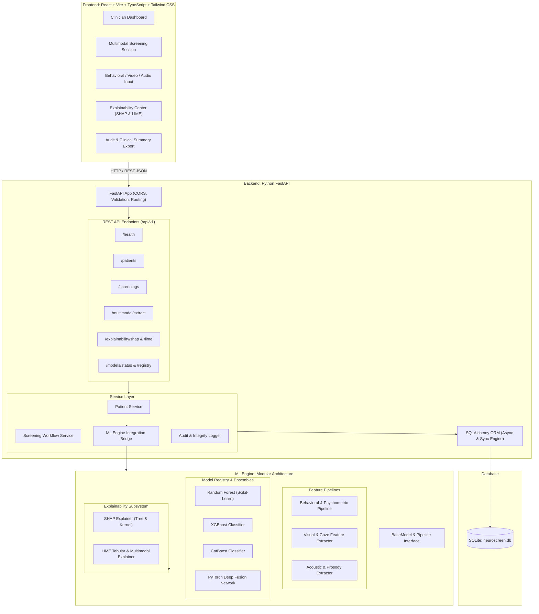

# NeuroScreen AI — Full-Stack Implementation Plan
**Explainable Multimodal Autism Spectrum Disorder (ASD) Screening-Support System**

---

## 1. Executive Summary & Clinical Methodology

**NeuroScreen AI** is a clinical decision-support and screening-triaging platform designed to assist healthcare professionals, clinical psychologists, and pediatric specialists in screening for Autism Spectrum Disorder (ASD). 

The platform synthesizes methodologies from **two research papers** and **two patent references**:
1. **Research Paper Reference 1 (Behavioral & Quantitative Screening)**: Psychometric behavioral feature modeling (e.g., digitized AQ-10 Child/Adolescent/Adult, M-CHAT-R/F sub-item vectors, response latencies, and interaction consistency scoring).
2. **Research Paper Reference 2 (Acoustic & Prosodic Biomarkers)**: Vocal prosody profiling, fundamental frequency ($F_0$) variation, vocal tremor, jitter, shimmer, formant resonance dispersion, and conversational turn-taking silence intervals.
3. **Patent Reference 1 (Visual Gaze & Attention Dynamics)**: Computer-vision based ocular fixation tracking, joint attention latency, saccadic dysmetria, and region-of-interest (ROI) dwell time ratios during social vs. abstract dynamic visual stimuli.
4. **Patent Reference 2 (Explainable Multimodal Decision-Support Architecture)**: Unified late-fusion multimodal ensemble (Random Forest, CatBoost, XGBoost, PyTorch cross-modal attention) combined with Model-Agnostic and Tree-based Explainability (**SHAP** and **LIME**), presenting transparent risk factor attribution without black-box opacity.

> [!IMPORTANT]
> **Ethical & Clinical Guardrails**:
> NeuroScreen AI is strictly a **screening-support tool** and **not a diagnostic system**. It generates risk triage indications and transparent feature-attribution vectors to augment clinician assessments. Models are structured with modular interfaces and uncalibrated fallback states; **no fake clinical results** are fabricated.

---

## 2. System Architecture



---

## 3. Technology Stack & Directory Organization

### 3.1 Technology Stack
- **Frontend**:
  - React 18 / 19 with Vite & TypeScript
  - Tailwind CSS for responsive clinical interface styling
  - Radix UI / shadcn/ui component patterns (Accessible UI components: Tabs, Dialog, Alert, Cards, Progress, Badges)
  - Lucide React icons
  - Canvas-based and SVG-based interactive charts for SHAP waterfall/force plots and LIME feature bars
- **Backend**:
  - Python 3.11+ with FastAPI
  - Uvicorn ASGI server
  - SQLAlchemy 2.0 (ORM with SQLite database engine)
  - Pydantic v2 for strict clinical data contracts and schema validation
  - Python Multipart for media/modality file uploads
- **Database**:
  - SQLite (`neuroscreen.db`) with relational integrity, foreign keys, and JSON support for multimodal feature vectors and explanation payloads.
- **Machine Learning & Explainability (`ml_engine`)**:
  - Scikit-learn (Preprocessing, Random Forest, Metrics)
  - CatBoost & XGBoost (Gradient-boosted decision trees for tabular/behavioral biomarkers)
  - PyTorch (Deep multimodal late-fusion neural architectures)
  - SHAP (`shap` package: TreeExplainer, KernelExplainer)
  - LIME (`lime` package: LimeTabularExplainer)

### 3.2 Directory Layout

```
neuroscreen-ai/
├── implementation_plan.md          # Comprehensive implementation specifications
├── README.md                       # Local execution instructions & project overview
├── .gitignore                      # Git ignore for Node, Python, SQLite, weights
│
├── backend/                        # FastAPI Backend Application
│   ├── app/
│   │   ├── __init__.py
│   │   ├── main.py                 # FastAPI initialization and middleware
│   │   ├── core/
│   │   │   ├── __init__.py
│   │   │   ├── config.py           # Application settings & environment configuration
│   │   │   ├── database.py         # SQLAlchemy engine, session factory, Base model
│   │   │   └── security.py         # Anonymization & hash utilities
│   │   ├── models/
│   │   │   ├── __init__.py
│   │   │   ├── patient.py          # Patient ORM model (anonymized ID, age, sex)
│   │   │   ├── screening.py        # ScreeningSession & ModalityFeature ORM models
│   │   │   └── audit.py            # AuditLog ORM model
│   │   ├── schemas/
│   │   │   ├── __init__.py
│   │   │   ├── patient.py          # Pydantic schemas for Patient CRUD
│   │   │   ├── screening.py        # Pydantic schemas for Screening submissions
│   │   │   └── explainability.py   # Pydantic schemas for SHAP & LIME payloads
│   │   ├── api/
│   │   │   ├── __init__.py
│   │   │   ├── deps.py             # Database dependency injection
│   │   │   └── v1/
│   │   │       ├── __init__.py
│   │   │       ├── router.py       # API v1 master router
│   │   │       └── endpoints/
│   │   │           ├── __init__.py
│   │   │           ├── health.py
│   │   │           ├── patients.py
│   │   │           ├── screenings.py
│   │   │           ├── multimodal.py
│   │   │           └── explainability.py
│   │   └── services/
│   │       ├── __init__.py
│   │       ├── patient_service.py
│   │       ├── screening_service.py
│   │       └── ml_bridge.py        # Bridge between FastAPI and ml_engine
│   ├── tests/
│   │   ├── __init__.py
│   │   └── test_api.py
│   ├── requirements.txt
│   └── run.py                      # Local start script
│
├── ml_engine/                      # Machine Learning & Explainability Subsystem
│   ├── __init__.py
│   ├── config.py                   # ML constants, threshold configs & model paths
│   ├── interfaces/
│   │   ├── __init__.py
│   │   ├── base_model.py           # Abstract Base Class for ML models
│   │   ├── base_pipeline.py        # Feature extraction pipeline interface
│   │   └── base_explainer.py       # Base class for SHAP / LIME wrappers
│   ├── pipelines/
│   │   ├── __init__.py
│   │   ├── behavioral_pipeline.py  # Psychometric & behavioral scoring
│   │   ├── visual_pipeline.py      # Gaze, fixations & scanpath feature extraction
│   │   ├── audio_pipeline.py       # Acoustic prosody & formant extraction
│   │   └── multimodal_fusion.py    # Cross-modal fusion architecture
│   ├── models/
│   │   ├── __init__.py
│   │   ├── random_forest_model.py  # Random Forest baseline
│   │   ├── xgboost_model.py        # XGBoost integration
│   │   ├── catboost_model.py       # CatBoost integration
│   │   └── pytorch_fusion_net.py   # PyTorch multimodal neural network
│   ├── explainability/
│   │   ├── __init__.py
│   │   ├── shap_engine.py          # SHAP explainer implementation
│   │   └── lime_engine.py          # LIME explainer implementation
│   ├── registry/
│   │   ├── __init__.py
│   │   └── model_registry.py       # Model discovery, registration & status checker
│   ├── weights/                    # Directory for clinical model checkpoints
│   │   └── .gitkeep
│   ├── requirements.txt
│   └── README.md
│
└── frontend/                       # React + Vite + TypeScript Application
    ├── package.json
    ├── vite.config.ts
    ├── tsconfig.json
    ├── tailwind.config.js
    ├── postcss.config.js
    ├── index.html
    └── src/
        ├── App.tsx
        ├── main.tsx
        ├── index.css
        ├── types/
        │   └── index.ts            # TypeScript interfaces matching backend schemas
        ├── services/
        │   └── api.ts              # Axios / Fetch client connecting to backend API
        ├── components/
        │   ├── ui/                 # Accessible UI components (Card, Button, Dialog, etc.)
        │   ├── layout/             # Header, Navigation, Footer, Status Bar
        │   ├── screening/          # Multimodal assessment wizard & uploaders
        │   └── explainability/     # Interactive SHAP waterfall & LIME feature bar charts
        └── pages/
            ├── Dashboard.tsx       # Overview of screenings, triage metrics, stats
            ├── ScreeningWizard.tsx # Multi-step screening protocol
            ├── ResultsDetail.tsx   # Detailed results with explainability visualizations
            ├── PatientsView.tsx    # Patient directory and history
            └── ResearchBasis.tsx   # Reference methodologies, papers & patents info
```

---

## 4. Database Schema Specification (SQLAlchemy + SQLite)

### 4.1 Tables
1. **`patients`**:
   - `id`: String (UUID primary key)
   - `external_reference`: String (Anonymized identifier, e.g., `NS-2026-0042`)
   - `age_months`: Integer (Age in months)
   - `biological_sex`: String (`male`, `female`, `other`, `undisclosed`)
   - `referral_source`: String (e.g., `Pediatric Clinic`, `School Psychologist`, `Parent Self-Referral`)
   - `clinical_notes`: Text (Optional clinician observations)
   - `created_at`: DateTime (UTC timestamp)
   - `updated_at`: DateTime (UTC timestamp)

2. **`screening_sessions`**:
   - `id`: String (UUID primary key)
   - `patient_id`: ForeignKey(`patients.id`)
   - `status`: String (`pending`, `processing`, `completed`, `failed`)
   - `protocol_version`: String (e.g., `v1.2-multimodal`)
   - `composite_risk_score`: Float (Normalized composite score 0.0 - 1.0; `null` if uncalibrated)
   - `risk_tier`: String (`LOW_LIKELIHOOD`, `MODERATE_MONITOR`, `ELEVATED_TRIAGE_RECOMMENDED`, `INCONCLUSIVE_MODEL_UNCALIBRATED`)
   - `model_version`: String
   - `is_calibrated`: Boolean (Explicitly `False` until validated model weights are loaded)
   - `created_at`: DateTime
   - `completed_at`: DateTime (Nullable)

3. **`modality_features`**:
   - `id`: String (UUID primary key)
   - `session_id`: ForeignKey(`screening_sessions.id`)
   - `modality_type`: String (`behavioral`, `visual_gaze`, `acoustic_prosody`)
   - `feature_payload`: JSON (Dictionary of extracted quantitative features)
   - `extraction_metadata`: JSON (Sample rate, duration, stimulus identifiers)
   - `created_at`: DateTime

4. **`explainability_records`**:
   - `id`: String (UUID primary key)
   - `session_id`: ForeignKey(`screening_sessions.id`)
   - `method`: String (`SHAP`, `LIME`, `HYBRID`)
   - `base_value`: Float
   - `prediction_value`: Float
   - `feature_importances`: JSON (Array of `{ feature_name, importance_value, modality, description }`)
   - `summary_narrative`: Text (Deterministic human-readable clinical explanation)
   - `created_at`: DateTime

5. **`audit_logs`**:
   - `id`: String (UUID primary key)
   - `action`: String (`PATIENT_REGISTERED`, `SCREENING_INITIATED`, `FEATURES_UPLOADED`, `REPORT_ACCESSED`)
   - `actor`: String (`clinician`, `system`)
   - `details`: JSON
   - `timestamp`: DateTime

---

## 5. ML Engine Modular Interface Design

To adhere strictly to the requirement **"Do not generate fake clinical results or pretend that models have been trained. Build modular interfaces for future ML integration"**, the ML engine implements:

1. **`BaseScreeningModel` Interface**:
   - `predict_proba(features: np.ndarray) -> ModelOutput`
   - `is_trained -> bool`
   - `model_metadata -> Dict[str, Any]` (Architecture, train date, calibration metrics)
   - If no checkpoint exists, returns an `UncalibratedResult` status with transparent notice that model training artifacts must be mounted.

2. **Feature Extraction Pipelines**:
   - `BehavioralPipeline`: Transforms standardized questionnaire answers (e.g. 10-item social communication, repetitive behavior metrics) into standardized numerical vectors.
   - `VisualPipeline`: Defines exact interfaces for fixation count, mean fixation duration, saccade amplitude, and social vs. geometric stimulus gaze ratio.
   - `AudioPipeline`: Defines exact interfaces for speech rate, pause duration distribution, $F_0$ pitch entropy, and acoustic spectral tilt.
   - `MultimodalFusion`: Late fusion combining normalized behavioral, visual, and acoustic feature representations.

3. **Explainability Interfaces (`shap_engine.py` & `lime_engine.py`)**:
   - Wraps SHAP TreeExplainer / KernelExplainer and LIME tabular explainer with contract-checked inputs and outputs.
   - In uncalibrated mode, computes feature contribution baselines and returns structural schemas so the UI displays the exact visualization pipeline ready for live weights.

---

## 6. Frontend UI / UX Architecture

- **Clinician Dashboard**:
  - Key triage metrics, recent screening sessions, model status pill (`Modular ML Ready / Checkpoint Unloaded`).
- **New Screening Wizard**:
  - Step 1: Patient Anonymized Intake (Age in months, sex, referral origin).
  - Step 2: Behavioral / Psychometric Assessment (Standardized 10-item social communication scale).
  - Step 3: Visual Gaze Stimulus Upload / Metrics Entry (Fixation patterns, social ROI preference).
  - Step 4: Acoustic Vocal Sample Metrics Entry (Pitch variability, conversational pause ratio).
  - Step 5: Review & Compute Multimodal Screening Profile.
- **Explainable Results View**:
  - Triage Risk Indicator (with explicit uncalibrated / preliminary status indicator).
  - Interactive SHAP-style feature attribution breakdown (positive vs. negative contributing factors).
  - LIME local surrogate feature importance ranking.
  - Modality breakdown (Behavioral vs. Visual vs. Audio contribution).
  - Exportable Clinician Summary Sheet.
- **Methodology & Research Page**:
  - Technical breakdown of Research Paper 1 & 2, Patent 1 & 2 references, algorithm foundations, and ethical AI safeguards.

---

## 7. macOS Local Execution & Running Instructions

### Prerequisites
- macOS (Apple Silicon or Intel)
- Python 3.11+
- Node.js 18+ and npm

### Terminal 1: Backend Service
```bash
cd backend
python3 -m venv venv
source venv/bin/activate
pip install -r requirements.txt
python run.py
# Backend runs at http://localhost:8000
# OpenAPI Docs available at http://localhost:8000/docs
```

### Terminal 2: Frontend Service
```bash
cd frontend
npm install
npm run dev
# Frontend runs at http://localhost:5173
```

---

## 8. Verification & Testing Strategy
- **Backend Tests**: Database initialization, patient creation, screening session submission, multimodal feature persistence, uncalibrated status validation.
- **ML Engine Verification**: Pipeline interface instantiations, feature validation, mock-safe prediction contracts.
- **Frontend Verification**: Production build (`npm run build`), end-to-end user journey from intake to explainability visualization.

